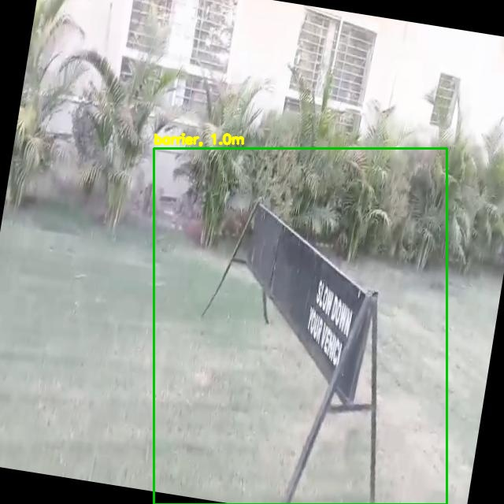
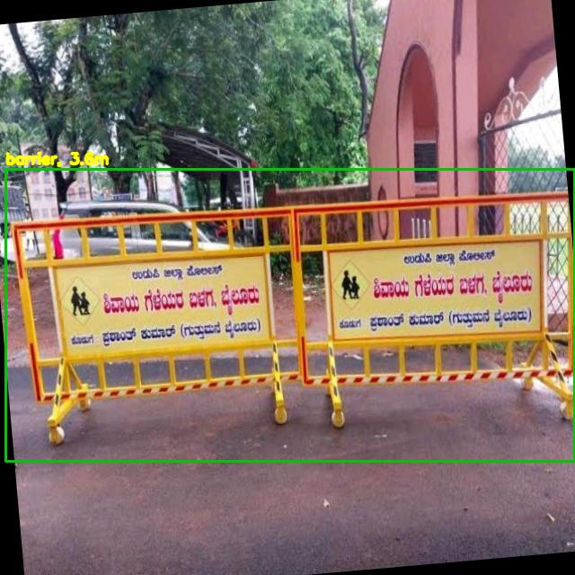
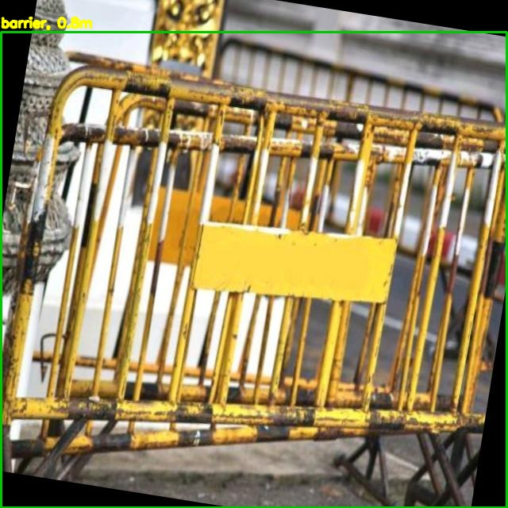
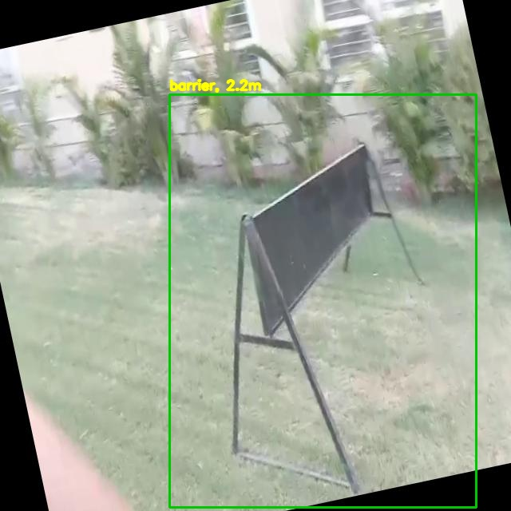
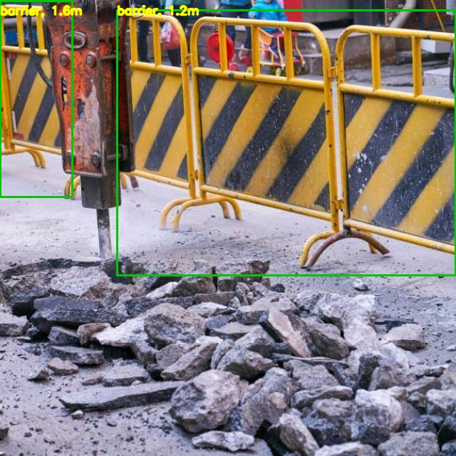
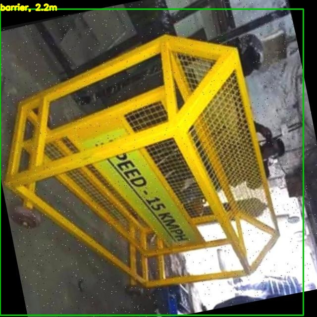
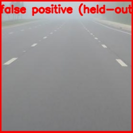

# YOLO11 Cone, Barrier, and Stop-Sign Detection

This project fine-tunes COCO-pretrained YOLO11n to detect road cones, barriers,
and stop signs, then estimates object distance from each bounding box. The
merged split has 4,770 images and 6,398 instances: 4,293 train images /
5,759 instances and 477 validation images / 639 instances.

## Problem and approach

The detector combines three sources because BDD100K alone does not provide
training classes for cones and barriers and its stop-sign labels are not the
three-class dataset needed here. YOLO11n supplies the detector; the final
classification head is re-initialised for three classes and fine-tuned from
COCO weights. `distance.py` applies known-size pinhole geometry and
ground-plane geometry, then fuses the available estimates.

### Datasets used

| Source | URL | Licence | Images / instances used |
|---|---|---|---:|
| TraCon cone export | The downloaded export did not retain its source URL | Not recorded in the export | 270 / 947 |
| Roboflow barrier, v1 | https://universe.roboflow.com/akshat-joshi-s-workspace/barrier-fn40g | CC BY 4.0 | 3,000 / 3,744 |
| COCO 2017 `stop sign` | https://cocodataset.org/#download | COCO terms | 1,500 / 1,707 |

The counts above are the merged train/validation counts. COCO stop signs are
used as labelled examples for the new class; COCO weights are not being
treated as stop-sign-specific detector weights. BDD100K was not mixed into
this run.

## Training

Training used `train.py`, YOLO11n, image size 640, batch 16, `freeze=0`, AMP,
and the two visible Tesla T4 GPUs (`device=0,1`). Early stopping ended the run
after 108 epochs in 1.006 hours. The final validation output was mAP50 0.938
and mAP50-95 0.789:

| Class | Validation images | Instances | mAP50 | mAP50-95 |
|---|---:|---:|---:|---:|
| cone | 27 | 94 | 0.957 | 0.803 |
| barrier | 300 | 372 | 0.970 | 0.817 |
| stop sign | 150 | 173 | 0.886 | 0.752 |

The architecture is the YOLO11n backbone, neck, and detection head, with the
classification output changed to three classes.

## Annotated examples

These six validation examples were generated with the committed checkpoint;
the last image is a verified false positive from the held-out TraCon cone
test at confidence 0.25.

| Example | Image |
|---|---|
| 1 |  |
| 2 |  |
| 3 |  |
| 4 |  |
| 5 |  |
| 6 |  |
| Failure: held-out false positive |  |

### Per-source split counts

| Source/class | Train images | Train instances | Val images | Val instances |
|---|---:|---:|---:|---:|
| cones / cone | 243 | 853 | 27 | 94 |
| barriers / barrier | 2,700 | 3,372 | 300 | 372 |
| COCO / stop sign | 1,350 | 1,534 | 150 | 173 |

## Edge benchmark

The PyTorch FP32 row is the baseline. Measurements are end-to-end
preprocess + inference + NMS, batch 1, image size 640, 100 validation images
preloaded in RAM, with 10 warm-up frames and CUDA synchronisation before
timing. The final table is also in
[results/benchmark.md](results/benchmark.md).

| Model | Variant | Device | FPS | mAP50 | mAP50-95 | File size (MB) |
|---|---|---|---:|---:|---:|---:|
| yolo11n | PyTorch FP32 (baseline) | CPU | 11.3 | 0.938 | 0.789 | 5.5 |
| yolo11n | PyTorch FP32 (baseline) | GPU | 103.2 | 0.938 | 0.789 | 5.5 |
| yolo11n | PyTorch FP16 | GPU | 79.6 | 0.937 | 0.788 | 5.5 |
| yolo11n | ONNX FP32 | CPU | 15.8 | 0.939 | 0.787 | 10.7 |
| yolo11n | OpenVINO INT8 | CPU | 23.4 | 0.937 | 0.780 | 3.4 |
| yolo11n | Pruned 30% | CPU | 12.7 | 0.882 | 0.722 | 5.5 |
| yolo11n | Pruned 30% | GPU | 92.2 | 0.882 | 0.722 | 5.5 |

OpenVINO INT8 is the fastest measured CPU option: 23.4 FPS versus 11.3 FPS
for baseline, at a 0.009 mAP50-95 cost. Its calibration export used the
training data supplied through `data=`; its mAP was measured on the same
merged validation split. The committed PyTorch checkpoint is FP16 on disk
(5.5 MB); true FP32 parameter storage is approximately 10.4 MB, so the 3.4
MB INT8 export is approximately 3.1x smaller than FP32 parameter storage.
Unstructured pruning leaves zeros uncompressed and therefore gave no dense
kernel speed or file-size benefit; without post-pruning fine-tuning, mAP50-95
dropped by 0.067.

GPU rows were rerun three times with 300 images on the same device index 0
(Tesla T4). The medians were 103.163 FPS for FP32 and 79.561 FPS for FP16.
FP16 was genuinely slower here: inference was 6.854 ms versus 3.994 ms for
FP32 while pre/post-processing was nearly unchanged. This batch-1, tiny-model
runtime is overhead/kernel-launch bound rather than showing the usual FP16
benefit; see [results/gpu_stage_timing.md](results/gpu_stage_timing.md).

Hardware and software details are recorded in
[results/hardware.txt](results/hardware.txt). This benchmark used a T4 and
4-vCPU Xeon; desktop/Colab FPS does not represent Jetson or Raspberry Pi
performance, so deployment choices must be remeasured on the target board.

## Data-validity checks

The barrier export contains augmented copies: comparing the prefix before
`.rf.` found 100 train/validation prefix overlaps. A hash-based check removed
282 merged validation images and retained 195 images with no matching train
image. On that leak-free subset, mAP50 was 0.932 and mAP50-95 was 0.796;
per-class mAP50-95 was cone 0.882, barrier 0.756, and stop sign 0.751.
The original 477-image validation result is retained above for comparability,
but the leak-free result is the more conservative estimate.

The TraCon source supplied a held-out test split. On its 40 images and 59 cone
instances, the model measured mAP50 0.983 and mAP50-95 0.876. At confidence
0.25 and IoU 0.5, 56 predictions matched ground truth and 6 predictions were
false positives. This is cone-only and is not a substitute for a three-class
held-out test.

## Distance estimation

The implementation is in [distance.py](distance.py). It uses

1. known-size pinhole distance, `Z = fy * H / h_px`;
2. ground-plane distance from camera height and angle below the horizon for
   cones and barriers only;
3. inverse-variance fusion in log-space;
4. a 40% disagreement threshold that selects the more certain method and
   marks the estimate low-confidence; and
5. truncation handling that inflates size uncertainty and disables the ground
   estimate when the box touches the lower image border.

These are assumptions, not calibration:

| Parameter | Value | Reason |
|---|---:|---|
| Horizontal FOV | 65 degrees | default camera assumption |
| Focal length at 1280 px | 1,008.8 px (derived) | pinhole conversion from 65-degree FOV |
| Camera height | 1.4 m | assumed lens height |
| Pitch | 0 degrees | assumed level camera |
| Cone height | 0.70 m | representative cone prior |
| Barrier height | 0.90 m | representative barrier prior |
| Stop-sign face height | 0.75 m | representative sign-face prior |

No measured distance ground-truth photos were available; estimates are
uncalibrated. Agreement between the two geometric methods is not validation,
because both depend on the same focal-length and camera assumptions. The
requested calibration/evaluation command is:

```bash
python eval_distance.py --csv data/dist_gt.csv --images data/dist_photos \
  --hfov 65 --cam-height 1.4
```

Sensitivity was measured by [sensitivity.py](sensitivity.py):

| Assumption change | 3m | 6m | 10m | 15m |
|---|---:|---:|---:|---:|
| focal length -10% | -12.7% | -12.7% | -12.7% | -12.7% |
| focal length +10% | +12.4% | +12.4% | +12.4% | +12.4% |
| camera height -0.1m | +0.0% | -4.8% | -3.9% | -2.9% |
| camera height +0.1m | +0.0% | +4.9% | +3.9% | +2.8% |
| pitch -1deg | +0.0% | -5.2% | -6.8% | -7.8% |
| pitch +1deg | +0.0% | +5.5% | +6.9% | +6.8% |
| object height -15% | -15.0% | -5.1% | -7.2% | -9.3% |
| object height +15% | +15.0% | +4.6% | +6.6% | +8.7% |

## Limitations

The validation set is small and contains mixed-source annotation styles and
same-source augmented duplicates. It has few hard negatives and no
three-class held-out test. Distance estimates assume camera parameters,
flat ground, representative object sizes, and complete/non-occluded boxes;
truncation, occlusion, and size variation can be substantial. Benchmark FPS
comes from a T4 and 4-vCPU Xeon, not an edge board.

## Reproduce

From the repository root:

```bash
pip install -r requirements.txt
python train.py --data data/merged/data.yaml --model yolo11n.pt \
  --imgsz 640 --batch 16 --freeze 0 --device 0,1
python optimize.py --weights weights/yolo11n_best.pt \
  --data data/merged/data.yaml --images data/merged/images/val \
  --n 100 --prune 0.3 --out results/benchmark.md
python sensitivity.py
pytest -q tests/test_distance.py
```

The training command requires two CUDA devices and deliberately refuses CPU
fallback.
